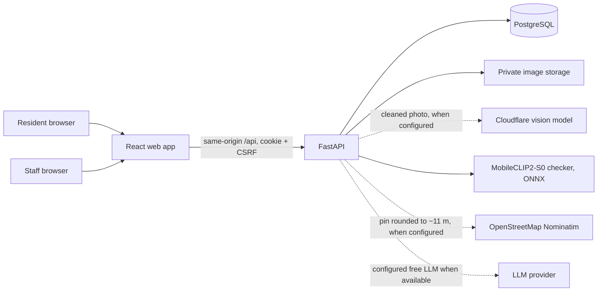
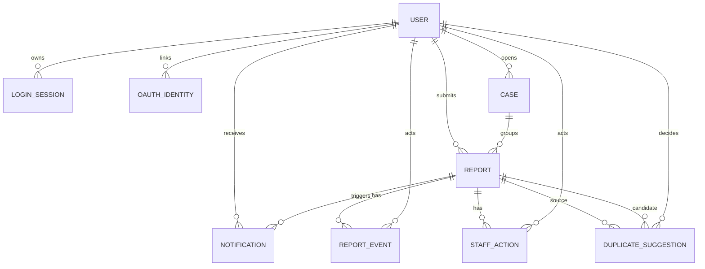

# Architecture and data flow

FastAPI alone decides ownership, roles, status changes, and access to original images. The browser sees only authenticated `/reports/{id}/image` responses. The model prediction, resident-selected category, and staff-verified category occupy distinct report fields. Model absence requires manual selection; staff still verifies all accepted reports. Chat report status uses a server-side scoped lookup, never a model-generated status.

`REPORT_EVENT` records actor and timestamp for each status change. `DUPLICATE_SUGGESTION` has a model version, score, decision, actor, and decision time; both original reports remain. New reports get suggestions automatically within a per-category radius (50 m for small fixtures, up to 300 m for floods). A `CASE` groups reports staff confirmed as one incident: each keeps its own photo, categories and history, they share one status (a joining report walks every step, logged), and a case's category comes only from staff verification. Accepted reports open a one-report case, which residents see on the shared map without photos, descriptions or names; a resident's "I see this too" report joins only after staff confirm it. Staff also see a suggested priority (`priority.py`): category severity, the AI's hazard flags, extra independent residents (at most +3) and a report in the last three days add points, shown with every reason. It never reorders the queue unless staff choose that sort, and residents never see it. Its weights are untuned starting values. Staff actions can record external coordination, but no API sends reports to another agency.

The selected Render container serves website and API under one origin. Supabase stores PostgreSQL rows and private photos. Sessions and authorization remain in FastAPI; Supabase client roles have no application-table policies. Storage credentials stay on the server, which checks report permissions before returning image bytes. Google identities map by provider and subject; matching password-account emails are not automatically linked.

## Status rules

`Pending` to `Under Verification` to `Accepted` to `In Progress` to `Resolved`. `Under Verification` may instead become `Rejected`. Acceptance requires a verified category. Residents can read their own reports and history; staff and administrators can read and update all reports.
